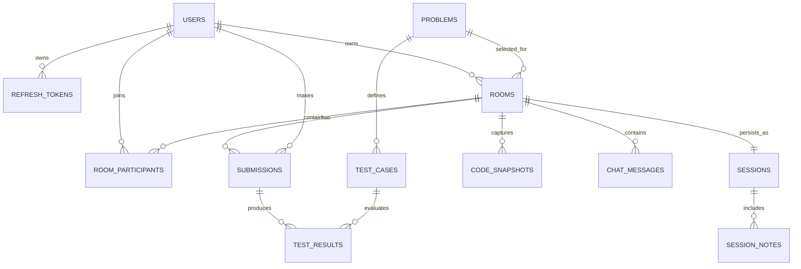

# PairCode data model

All primary keys are UUIDs. Room IDs are separately stored as human-shareable `PC-XXXXX` codes. Hidden test inputs and expected values never leave the server; only the boolean/runtime result is serialised.
